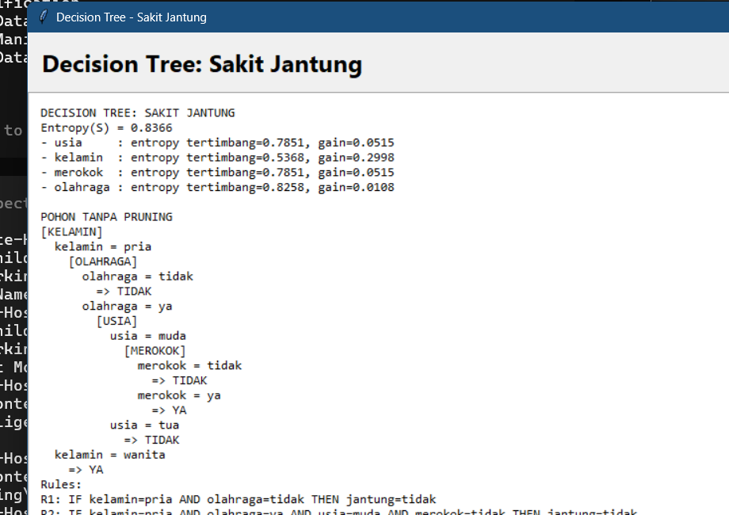

<div align="center">

# Machine Learning Courses

### Implementasi algoritma Machine Learning klasik — Find-S & Decision Tree ID3

[](https://www.python.org/)
[](https://openjdk.org/)
[](https://docs.python.org/3/library/tkinter.html)
[](LICENSE)

Kumpulan praktikum mata kuliah **Machine Learning**: konsep hipotesis Find-S dan pembangunan Decision Tree ID3, lengkap dengan GUI interaktif untuk studi kasus diagnosis.

</div>

---

## Preview GUI

<div align="center">
  
</div>

## Materi

| Topik | Lokasi | Deskripsi |
|---|---|---|
| **Find-S** | [`find-s/`](find-s/) | Algoritma Find-S untuk mencari hipotesis paling spesifik dari data training positif |
| **Decision Tree ID3** | [`decision-tree/`](decision-tree/) | Pohon keputusan berbasis Information Gain / Entropy dengan GUI Tkinter |
| **Materi kuliah** | [`materials/`](materials/) | Slide / modul PDF (Minggu 4 — Decision Tree) |

## Struktur Repository

```text
machine-learning-courses/
├── assets/
│   └── screenshots/          # Screenshot GUI untuk dokumentasi
├── decision-tree/
│   ├── sakit_jantung.py      # Deteksi penyakit jantung (GUI)
│   ├── latihan_hipertensi.py # Latihan diagnosis hipertensi (GUI)
│   └── gangguan_layanan_server.py  # Deteksi gangguan server jaringan (GUI)
├── find-s/
│   ├── find_s.py             # Implementasi Find-S (Python)
│   └── FindS.java            # Implementasi Find-S (Java)
├── materials/
│   └── Minggu-4-Decision-Tree.pdf
├── LICENSE
└── README.md
```

## Cara Menjalankan

### 1. Find-S (Python)

```bash
python find-s/find_s.py
```

Output berupa hipotesis untuk tiap kelas keputusan dari dataset cuaca sederhana.

### 2. Find-S (Java)

```bash
javac find-s/FindS.java
java -cp find-s FindS
```

### 3. Decision Tree ID3 (GUI)

Tidak ada dependensi eksternal — cukup Python 3 dengan Tkinter.

```bash
python decision-tree/sakit_jantung.py
python decision-tree/latihan_hipertensi.py
python decision-tree/gangguan_layanan_server.py
```

Di dalam GUI:

1. Lihat dataset latih yang sudah terpasang (bisa dimuat ulang dari CSV).
2. Tekan tombol untuk **membangun pohon keputusan**.
3. Amati perhitungan **Entropy**, **Information Gain**, dan struktur pohon.
4. Lakukan **prediksi** kasus baru lewat form fitur.

## Algoritma

### Find-S

Menginisialisasi hipotesis dengan atribut positif pertama, lalu memperketatnya (`?` / `*` / nilai spesifik) setiap kali menemukan data training positif yang konsisten. Cocok untuk memahami batas konsep dalam version space.

### Decision Tree ID3

1. Hitung **Entropy** setiap partisi data.
2. Hitung **Information Gain** tiap atribut.
3. Pilih atribut dengan gain terbesar sebagai simpul percabangan.
4. Rekursif sampai daun murni atau kriteria berhenti terpenuhi.

## Dataset

Dataset demo bersifat kecil dan edukatif (cuaca, hipertensi, penyakit jantung, gangguan server), sehingga mudah ditelusuri manual. File CSV opsional dapat dimuat dari GUI.

## Catatan Pembelajaran

- Find-S hanya melihat sampel **positif**, sehingga hipotesisnya cenderung paling spesifik.
- ID3 sensitif terhadap atribut dengan banyak nilai unik; Information Gain Ratio dapat memitigasi bias tersebut.
- Dataset kecil mudah overfit — penting memahami validasi sebelum mempercayai akurasi training.

## Penulis

**Ahmad Nabah Falah** — [@ausartal](https://github.com/ausartal)
